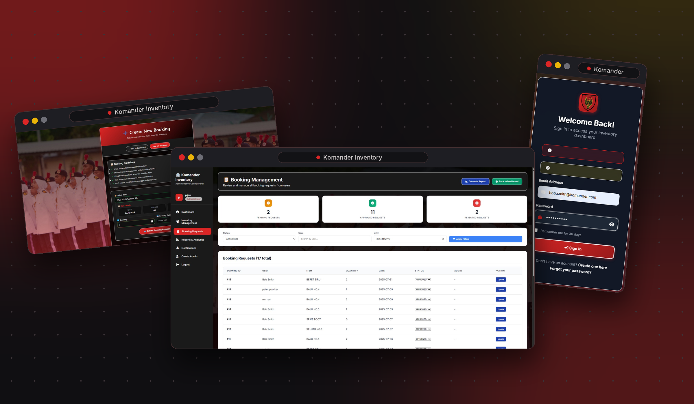
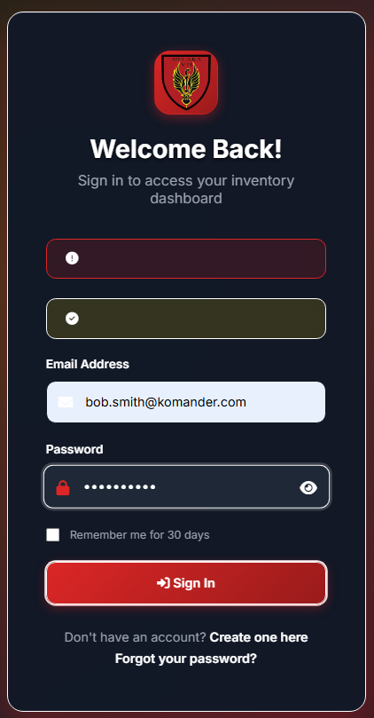
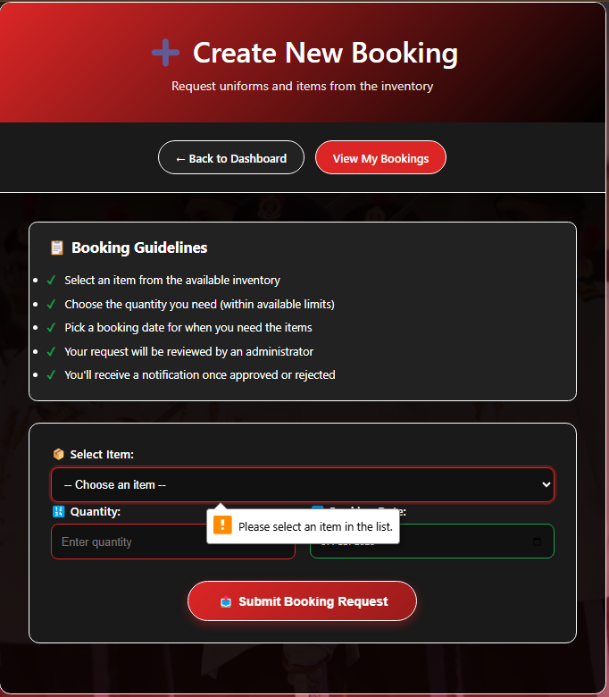
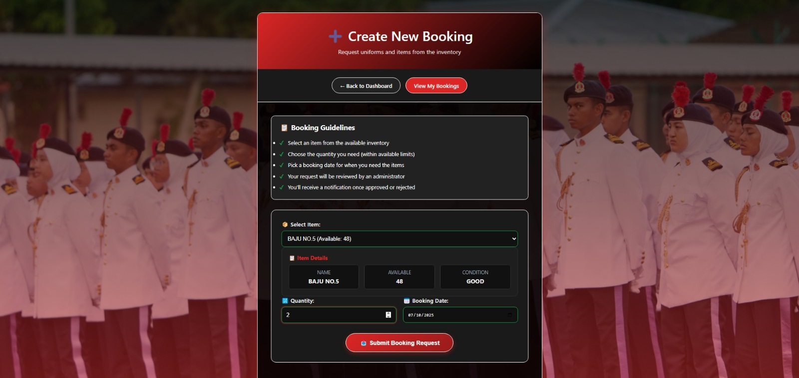
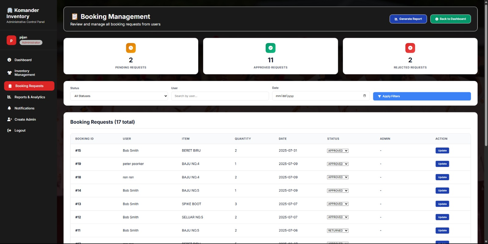
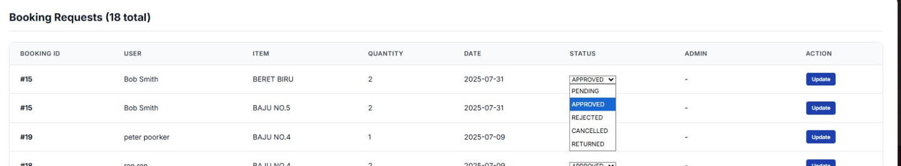
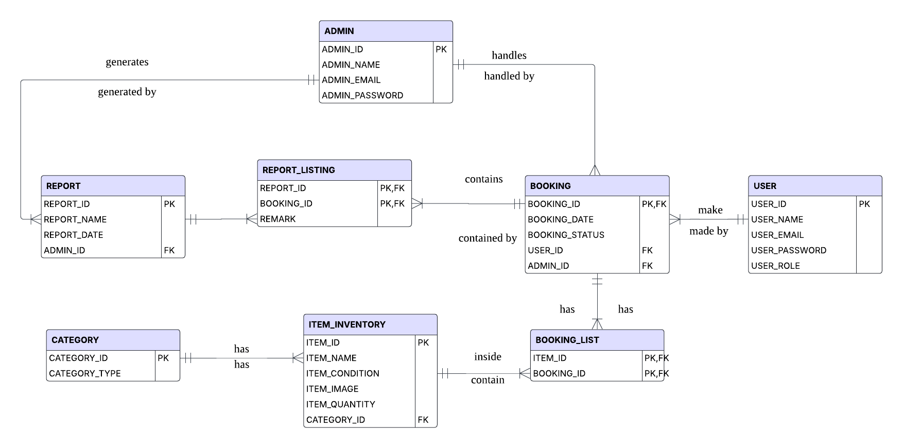
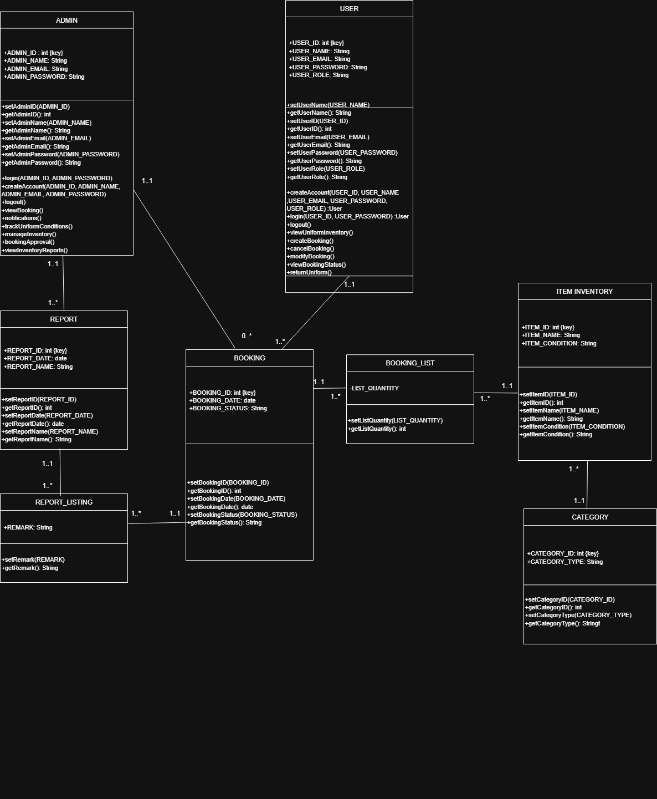
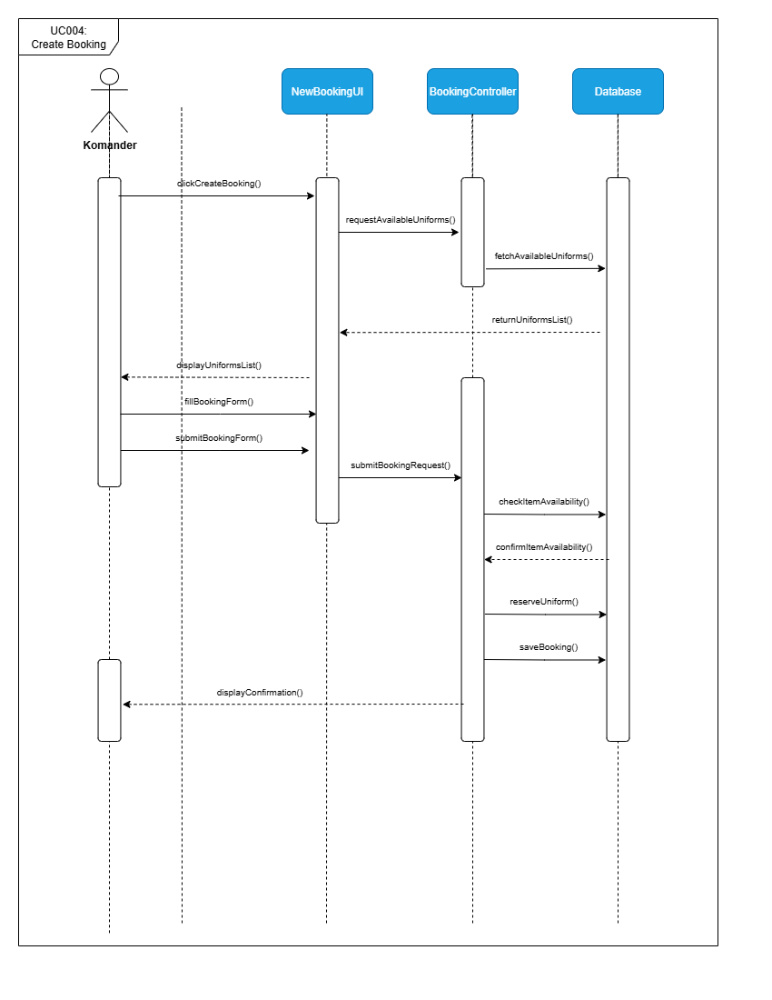
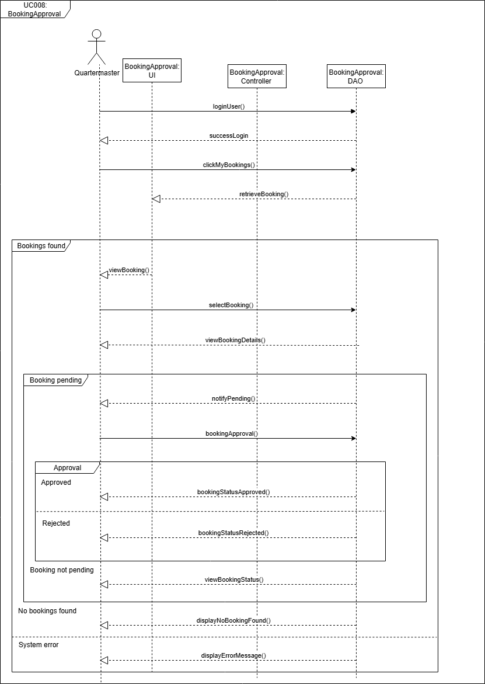

  

<h1 align="center">Komander Kesatria Uniform Management System</h1>

  A web-based system for borrowing, returning and managing uniforms for Komander Kesatria, UiTM Cawangan Melaka Kampus Jasin.

---

## 📌 About

Komander Kesatria members used to borrow and return uniforms through a manual, paper-based process. This made it hard to know which uniforms were available, who was holding them, and when they were due back.

This system replaces that process with a web platform that offers **real-time booking, approval and inventory tracking**:

- Members can see what is available and book uniforms online, without checking the store in person.
- Quartermasters can approve requests and keep the inventory up to date.
- Young Officers can monitor borrowing activity through reports.

> Group project for **CSC577 Software Engineering: Theories and Principles**, Faculty of Computer and Mathematical Sciences, UiTM Cawangan Melaka Kampus Jasin.

## ✨ Features

**Role-based access.** Each role sees a different interface and only the actions it is permitted to take.

| Role | What they can do |
|---|---|
| 🎖️ **Komander** (member) | Book, modify and cancel uniform reservations · View uniform availability · Receive due-date and booking notifications |
| 🧰 **Quartermaster** (administrator) | Approve or reject bookings · Set return due dates · Track inventory, ownership and uniform condition · Update booking status (Pending, Approved, Rejected, Cancelled, Returned) |
| 📊 **Young Officer** | Monitor borrowing activity · View generated reports |

**Highlights**
- **Real-time inventory tracking** prevents overbooking, misinformation and data redundancy.
- **Booking validation** checks requested quantities against available stock.
- **Automated notifications** alert users and administrators about announcements and uniform return dates.
- **Admin dashboard** shows pending, approved and rejected requests, with filters by status, user and date.

## 🖼️ Screenshots

| User Login | Booking Validation |
|---|---|
|  |  |

**Create New Booking**

**Booking Management (Administrator)**

**Booking Status Update**

## 🛠️ Tech Stack

| Layer | Technology |
|---|---|
| Architecture | MVC: Java Servlets as controllers, JSP pages as views |
| Frontend | JSP, JSTL, HTML, CSS, JavaScript |
| Backend | Java 21, Jakarta Servlets |
| Database | MySQL (JDBC with MySQL Connector/J) |
| Server | Apache Tomcat 10 or newer (Jakarta EE) |

## 📐 Software Design

The system was designed and documented following software engineering practices: a **Software Requirements Specification (SRS)**,
a **Software Design Description (SDD)** and a **Software Test Report (STR)**. Selected diagrams from the SDD:

### Database design (ERD)

### Class diagram

### Sequence diagrams

| Create Booking (Komander) | Booking Approval (Quartermaster) |
|---|---|
|  |  |

The STR covers use case testing for user login, admin login, create booking and booking approval.

## 💻 Source Code

This was built as a **group project** with three teammates, so the source code is kept private. It's available on request for interviews.
